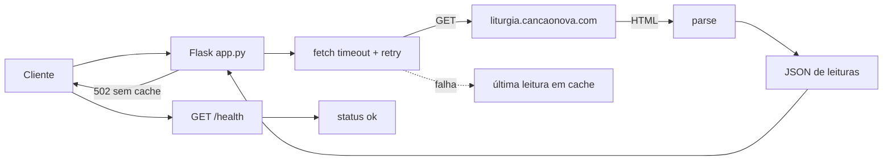

<div align="center">

# API Liturgia Diária

**Leituras litúrgicas diárias via API JSON** — extraídas de [liturgia.cancaonova.com](https://liturgia.cancaonova.com/pb/) a cada requisição, para facilitar a criação de aplicações que almejam a evangelização.

[](https://github.com/soaresfellipe/api-liturgia-ptbr/actions/workflows/ci.yml)
[](https://github.com/soaresfellipe/api-liturgia-ptbr/actions/workflows/codeql.yml)


</div>

---

## Destaques

- **Zero banco de dados** — cada requisição coleta a liturgia do dia na fonte e devolve JSON pronto para consumo.
- **Resiliente por padrão** — timeout + retry com backoff no scraping; em falha, serve a última leitura em cache; sem cache, responde `502` estruturado.
- **Observável** — `/health` para probes e logging estruturado (uma linha JSON por evento).
- **Bem tipada e verificada** — type hints em todo o código, `mypy --strict`, 26 testes com ~96% de cobertura e testes de integração opcionais contra a fonte real.
- **Pronta para CI/CD** — GitHub Actions (CI em Python 3.12 e 3.13), CodeQL, gitleaks e Dependabot.

## Como funciona



| Módulo | Responsabilidade |
| --- | --- |
| `app.py` | Rotas `/` e `/health`, logging estruturado em JSON |
| `extractor/extractor_service.py` | Fetch (timeout + retry) e parse do HTML da liturgia; fallback em memória |
| `extractor/utils.py` | Helpers de formatação e limpeza de HTML |
| `tests/` | Suíte pytest com fixture HTML da fonte |

> [!IMPORTANT]
> A fonte é um site externo: mudanças no HTML podem quebrar o parser. O diagnóstico passo a passo está no [runbook](docs/runbook.md) — e a skill `update-parser` (`.factory/skills/`) guia a correção com agentes.

## Estrutura do projeto

```text
.
├── app.py                        # rotas / e /health, logging JSON
├── extractor/
│   ├── extractor_service.py      # fetch (timeout + retry) e parse
│   └── utils.py                  # parse de data e limpeza de HTML
├── tests/
│   ├── fixtures/liturgia.html    # snapshot real da página da fonte
│   ├── test_app.py               # rotas Flask (test client)
│   ├── test_extractor.py         # parse contra o fixture + integração
│   └── test_utils.py             # utilitários
├── docs/runbook.md               # operação: 502, parser quebrado, deploy
├── openapi.yaml                  # especificação OpenAPI da API
├── .factory/skills/update-parser # skill para agentes corrigirem o parser
└── vercel.json                   # configuração de deploy
```

## Requisitos

- Python 3.12+ (testado até 3.13)
- pip

## Setup (do clone ao rodando)

Linux/macOS:

```bash
python -m venv .venv && source .venv/bin/activate && pip install -r requirements.txt -r requirements-dev.txt && flask --app app run
```

Windows (PowerShell):

```powershell
python -m venv .venv; .venv\Scripts\Activate.ps1; pip install -r requirements.txt -r requirements-dev.txt; flask --app app run
```

O servidor sobe em `http://localhost:5000`.

## Comandos

| Ação | Comando |
| --- | --- |
| Rodar localmente | `flask --app app run` |
| Testes (unidade) | `pytest` |
| Testes de integração (bate na fonte real) | `pytest -m integration` |
| Cobertura | `pytest --cov-report=term-missing` |
| Lint | `ruff check .` |
| Formatar | `ruff format .` |
| Type check (strict) | `mypy` |
| Dependências ausentes/não usadas | `deptry .` |
| Código morto | `vulture app.py extractor` |
| Complexidade ciclomática | `radon cc --min C app.py extractor` |
| Hooks de pre-commit | `pre-commit install` |

## API

| Endpoint | Descrição |
| --- | --- |
| `GET /` | Leituras litúrgicas do dia em JSON |
| `GET /health` | Health check (`{"status": "ok", "timestamp": "..."}`) |

A especificação completa está em [`openapi.yaml`](openapi.yaml).

### Exemplo

```bash
curl http://localhost:5000/
```

```json
{
  "objective": "A API_LITURGIA_DIARIA visa disponibilizar via api as leituras para facilitar a criação de aplicações que almejam a evangelização.",
  "source": "Canção Nova",
  "today": {
    "date_string": { "day": "19", "month": "Out", "year": "2026" },
    "date": "19/10/2026",
    "color": "Verde",
    "entry_title": "29ª Semana do Tempo Comum | Segunda-feira",
    "readings": {
      "first_reading": { "title": "...", "head": "...", "text": "...", "footer": "...", "footer_response": "...", "all_html": "..." },
      "psalm": { "title": "...", "response": "...", "content_psalm": ["...", "..."], "all_html": "..." },
      "gospel": { "title": "...", "head": "...", "head_response": "...", "text": "...", "footer": "...", "footer_response": "...", "all_html": "..." }
    }
  }
}
```

### Campos de cada leitura

| Campo | Descrição |
| --- | --- |
| `title` | Referência da leitura (ex.: `Primeira Leitura (Ef 2,1-10)`) |
| `head` | Cabeçalho/introdução da leitura |
| `head_response` | Resposta do cabeçalho (apenas no evangelho) |
| `text` | Corpo da leitura, em texto corrido |
| `footer` | Conclusão (ex.: `Palavra do Senhor.`) |
| `footer_response` | Resposta da conclusão (ex.: `Graças a Deus.`) |
| `all_html` | HTML original da seção, completo |

No salmo, o corpo vem em `content_psalm` (lista de versículos) e a antífona em `response`.

> A 2ª leitura (`second_reading`) aparece apenas nos dias em que a liturgia a prevê.

### Comportamento em falha

| Situação | Resposta |
| --- | --- |
| Fonte ok | `200` com `source: "Canção Nova"` |
| Fonte falhou, há leitura anterior em cache | `200` com `source: "Canção Nova (cache)"` |
| Fonte falhou e não há cache | `502` com `{"error": "upstream_unavailable"}` |

> O cache de fallback é mantido em memória por instância do runtime (em serverless, por instância de função, não global).

## Variáveis de ambiente

Copie `.env.example` e exporte as variáveis desejadas (ou configure-as na Vercel):

| Variável | Padrão | Descrição |
| --- | --- | --- |
| `LITURGIA_BASE_URL` | `https://liturgia.cancaonova.com/pb/` | URL da página de onde as leituras são extraídas |
| `LOG_LEVEL` | `INFO` | Nível de log (DEBUG, INFO, WARNING, ERROR) |

## Qualidade e CI

O CI roda em Python 3.12 e 3.13 e bloqueia o merge se falhar:

| Verificação | Ferramenta |
| --- | --- |
| Lint + formatação + nomenclatura | `ruff check` / `ruff format` |
| Tipagem | `mypy --strict` |
| Testes + cobertura (mínimo 80%) | `pytest` |
| Dependências | `deptry` |
| Código morto | `vulture` |
| Complexidade | `radon cc --min C` |
| Segurança (SAST) | CodeQL |
| Segredos | gitleaks (pre-commit + CI) |

Antes de commitar: `pre-commit install` roda a maioria dessas verificações localmente. Os pins de dependência são exatos (`==`) e releases muito recentes (menos de 7 dias) só são adotados com necessidade — política detalhada no [`AGENTS.md`](AGENTS.md).

## Deploy

O `vercel.json` já contém a configuração de build. Como este repositório é um **fork**, conecte-o a um projeto próprio na Vercel (Import Project → este repositório) para habilitar o deploy automático a cada push na `main`. A URL `api-liturgia-diaria.vercel.app` pertence ao repositório original e não reflete este código.

## Contribuição

1. Abra uma [issue](../../issues) usando o template de bug ou de funcionalidade.
2. Envie um PR para a `main` — o template do PR lista o checklist de validação.
3. O CI valida lint, tipagem, testes, dependências e segurança antes do merge.

Para operação e incidentes (fonte fora do ar, parser quebrado), consulte o [runbook](docs/runbook.md).

## Fonte e créditos

- Leituras: [Canção Nova — Liturgia Diária](https://liturgia.cancaonova.com/pb/)
- Projeto original: `api-liturgia-ptbr` — este repositório é um fork mantido com melhorias de robustez, qualidade e operação.
