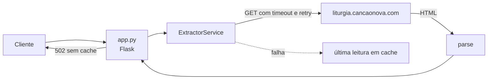

# API Liturgia Diária

API Flask que disponibiliza via API as leituras litúrgicas diárias (fonte: [Canção Nova](https://liturgia.cancaonova.com/pb/)), coletadas a cada requisição, para facilitar a criação de aplicações que almejam a evangelização.

**URL em produção:** <https://api-liturgia-diaria.vercel.app/>

## Tecnologias

- Python 3.12+ (testado até 3.13)
- Flask
- Beautiful Soup

## Requisitos

- Python 3.12 ou mais recente
- pip

## Setup (do clone ao rodando)

Linux/macOS:

```bash
python -m venv .venv && source .venv/bin/activate && pip install -r requirements.txt -r requirements-dev.txt && flask --app app run
```

Windows (PowerShell):

```powershell
python -m venv .venv; .venv\Scripts\Activate.ps1; pip install -r requirements.txt -r requirements-dev.txt; flask --app app run
```

O servidor sobe em `http://localhost:5000`.

## Comandos

| Ação | Comando |
| --- | --- |
| Rodar localmente | `flask --app app run` |
| Testes (unidade) | `pytest` |
| Testes de integração (bate na fonte real) | `pytest -m integration` |
| Cobertura | `pytest --cov-report=term-missing` |
| Lint | `ruff check .` |
| Formatar | `ruff format .` |
| Type check | `mypy app.py extractor` |
| Dependências não utilizadas | `deptry .` |
| Código morto | `vulture app.py extractor` |
| Complexidade | `radon cc --min C .` |
| Hooks de pre-commit | `pre-commit install` |

## Exemplo de requisição

```bash
curl http://localhost:5000/
```

```json
{
  "objective": "A API_LITURGIA_DIARIA visa disponibilizar via api as leituras para facilitar a criação de aplicações que almejam a evangelização.",
  "source": "Canção Nova",
  "today": {
    "date_string": { "day": "19", "month": "Out", "year": "2026" },
    "date": "19/10/2026",
    "color": "Verde",
    "entry_title": "29ª Semana do Tempo Comum | Segunda-feira",
    "readings": {
      "first_reading": { "title": "...", "head": "...", "text": "...", "footer": "...", "footer_response": "...", "all_html": "..." },
      "psalm": { "title": "...", "response": "...", "content_psalm": ["...", "..."], "all_html": "..." },
      "gospel": { "title": "...", "head": "...", "head_response": "...", "text": "...", "footer": "...", "footer_response": "...", "all_html": "..." }
    }
  }
}
```

A 2ª leitura (`second_reading`) aparece apenas nos dias em que a liturgia a prevê.

### Health check

```bash
curl http://localhost:5000/health
# {"status": "ok", "timestamp": "2026-10-19T12:00:00+00:00"}
```

## Variáveis de ambiente

Copie `.env.example` e exporte as variáveis desejadas (ou configure-as na Vercel):

| Variável | Padrão | Descrição |
| --- | --- | --- |
| `LITURGIA_BASE_URL` | `https://liturgia.cancaonova.com/pb/` | URL da página de onde as leituras são extraídas |
| `LOG_LEVEL` | `INFO` | Nível de log (DEBUG, INFO, WARNING, ERROR) |

## Arquitetura



- `app.py` — rotas `/` e `/health`, logging estruturado em JSON.
- `extractor/ExtractorService.py` — fetch (timeout + retry) e parse do HTML da liturgia; em falha, serve a última extração bem-sucedida em memória.
- `extractor/Utils.py` — helpers de formatação e limpeza de HTML.

A fonte (`liturgia.cancaonova.com`) é um site externo: mudanças no HTML podem quebrar o parser. Consulte [docs/runbook.md](docs/runbook.md) para diagnóstico e correção.

## Deploy

O deploy é automático na Vercel a cada push na `main` (configuração em `vercel.json`).
